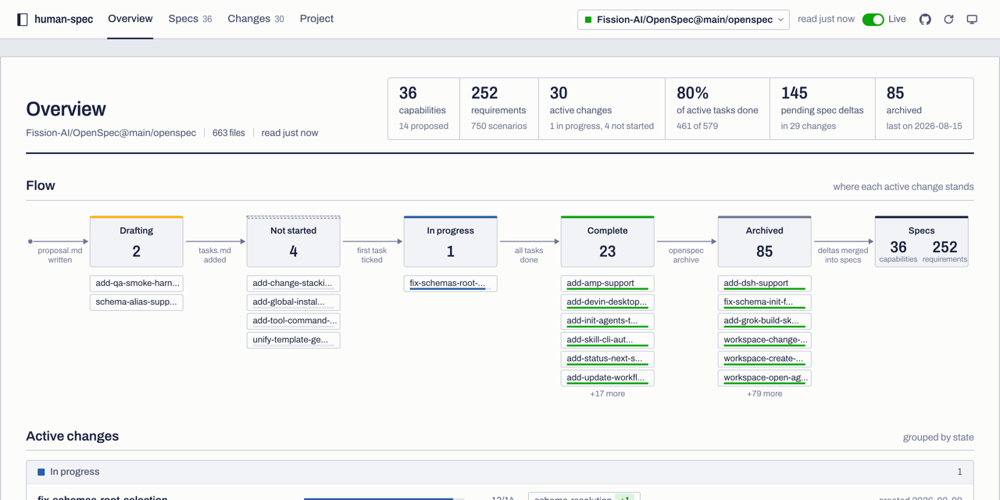

# human-spec

Openspec is built for agents. What makes it powerful, makes it difficult for humans to follow.
Human-specs makes it easier for humans to follow along.

I suggest against trying to read openspec. Let agents do their thing. Use human-spec to get the bird's eye view.
 
An OpenSpec viewer. One HTML file, no build step, no dependencies. Point it at any repository that holds an `openspec/` folder and it shows the capabilities and their requirements, the changes in flight and in the archive, the spec deltas each change proposes, and how far its tasks have come.

OpenSpec is text first, which suits agents and tires humans. human-spec is the human side: a read-only dashboard for keeping an eye on the state of the specs and the progress of the work.



## Open it

**Straight from disk.** Open `index.html` in Chrome or Edge. The folder picker and live refresh work from a `file://` address.

**From a local server.** Any static server will do:

```bash
python3 -m http.server 8080
```

then open <http://localhost:8080/>. Served pages can also be installed as an app, which lets the browser remember folder permissions.

## Sources

- **Local folder.** Click "Choose folder…" and pick the repository root, or the `openspec/` folder itself, or drop a folder anywhere on the page. Files are read in the browser and never uploaded. With "Live" on, the page re-reads the folder every 3 seconds and redraws when a file changes.
- **GitHub.** Enter `owner/repo`, `owner/repo@branch`, or a github.com link. Public repositories need no token. Private ones take a fine-grained token with read access to contents; it stays in this browser.

The browser asks once per folder whether the page may "view and copy" files. That is its wording for read access. The page reads the Markdown and YAML into memory and sends nothing anywhere, except to GitHub when you choose a GitHub source, and to Google Fonts for type (it falls back to system fonts offline).

## What it shows

- **Overview.** A title block of counts, a ledger of active changes grouped by state, the next open tasks per change in progress, a needs-attention list, an impact matrix of change × capability, the capabilities, and the archive history.
- **Specs.** Each capability's purpose and requirements with their scenarios. Requirements carry badges linking to the active change that modifies, removes or renames them. Proposed additions appear below.
- **Changes.** Proposal, tasks grouped by section with progress, spec deltas with a word-level diff of each modified requirement against the current spec, design, and the file list.
- **Project.** `project.md` and `config.yaml`.
- **Needs attention.** Deltas that modify or remove a requirement the spec no longer has, additions that collide with an existing name, requirements without scenarios, changes with tasks but no deltas, and changes whose tasks are all done but which are not archived.

## Programmatic use

The page exposes `window.OSV` with `loadFiles(files, label)`, where `files` is an array of `{ path, text, mtime }`, plus the parsers (`parseSpec`, `parseDelta`, `parseTasks`), `buildModel`, and the Markdown renderer. `window.OSV_MODEL` holds the current model.

## Layout

```
human-spec/
├── index.html        the whole application
├── docs/
│   └── showcase.png  overview screenshot used in this README
├── LICENSE           MIT
└── README.md
```

## License

MIT. See [LICENSE](LICENSE). Use it, change it, ship it, commercially or not; keep the copyright notice.

The name "human-spec" and the human-spec.dev domain are not covered by the license. Forks are welcome, but should not present themselves as the official site or project.

Fonts are loaded from Google Fonts: [Archivo](https://fonts.google.com/specimen/Archivo) and [Source Serif 4](https://fonts.google.com/specimen/Source+Serif+4), both under the SIL Open Font License 1.1.
